# scummvm-ai-upscale: real-time AI upscaling for classic SCUMM adventures

An unofficial fork of [ScummVM](https://www.scummvm.org) 2026.3.0 that upscales the classic LucasArts SCUMM
adventures that never got a remaster, live on your graphics card with neural networks. Every frame (backgrounds,
characters, interface and cutscenes) is upscaled on the fly, so whatever the engine draws is upscaled exactly where
it is drawn; no pre-made art pack is needed. Room backgrounds additionally get a cleaner pass from a heavier model
in the background, and text stays in the game's own font, pixel-sharp.
**True widescreen:** rooms wider than the screen show a real 16:9 view of the room; narrower rooms get an ambient
glow at the sides. See [How it works](#how-it-works) for the technical details.

| Game | Status |
|---|---|
| **The Curse of Monkey Island** (1997) | complete: 3x, true widescreen, HD characters and backgrounds, optional [side art you make yourself](#bring-your-own-side-art) |
| **The Dig** (1995) | experimental: 4x, true widescreen; [details](#the-dig-experimental) |
| **Indiana Jones and the Fate of Atlantis** (1992) | experimental: 4x, true widescreen, verb panel kept at its size; [details](#indiana-jones-experimental) |
| **Indiana Jones and the Last Crusade** (1989, VGA) | experimental: as Fate of Atlantis; [details](#indiana-jones-experimental) |
| **Loom** (1990, VGA CD talkie) | experimental: 4x, true widescreen, the musical staff kept pixel-sharp; [details](#loom-and-sam--max-experimental) |
| **Sam & Max Hit the Road** (1993, CD) | experimental: 4x, true widescreen; [details](#loom-and-sam--max-experimental) |

Experimental means: every room loads and shows correctly in automated sweeps, but the game has not been played
through with the remaster yet. Reports are welcome.

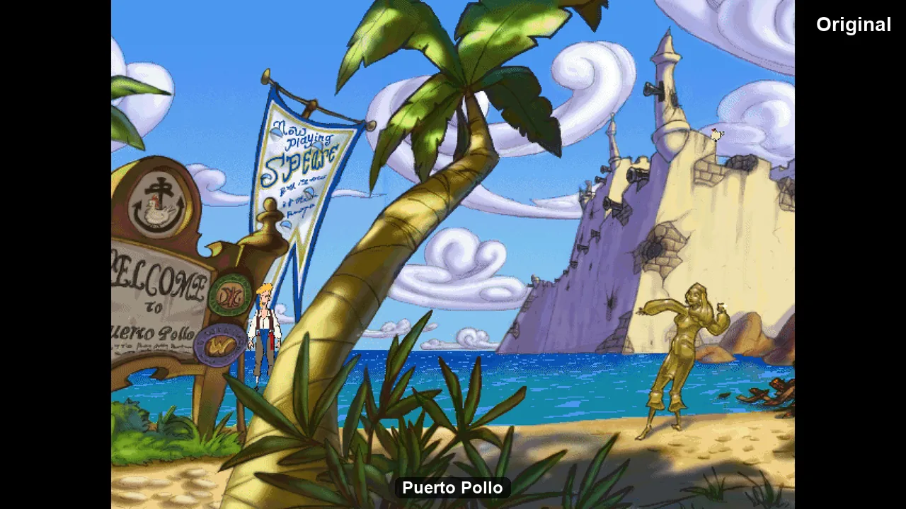

> **You need your own copy of the games** (Steam or GOG). This project contains no game data.

## What's AI and what isn't

Some people would rather know exactly where AI is involved before they play. In short: **the game is always the
original, and nothing made by AI is downloaded.**

| | What it is | AI? | Where it comes from |
|---|---|---|---|
| The game itself (story, rooms, characters, animation, voices, music) | the original, from your own copy | no | your own copy (Steam, GOG or your own discs); this project contains none of it |
| **Original** look (F10) | the original pixels, just scaled | no | |
| **VGA / EGA / Amiga / Modern pixel art** looks | colour and pixel conversions | no | calculated live |
| **AI HD** look | the picture sharpened to your screen's resolution | yes, live | an upscaling network running on your graphics card, frame by frame; nothing is stored or sent anywhere |
| HD backgrounds, HD characters | the same, with a heavier model for backgrounds | yes, live | as above; backgrounds are cached on your PC |
| Ambient glow beside narrow rooms | a blurred continuation of the picture's edges | no | calculated live |
| Zoom to fill | the original picture, enlarged | no | |
| **Side art** (optional, The Curse of Monkey Island) | painted scenery beside the narrow rooms | your choice | painted by you, or generated on your own PC from your own copy if you choose to (local model, or your own OpenRouter account) |

Every AI step only ever works from your own copy of the game, on your machine (or your own cloud account, if you
pick that). The original room is always drawn untouched in the middle, and **F10 switches to the original pixels
at any moment**; the **Original (no AI)** choice in the installer starts you there.

## Project status: the remaster kit (in development)

Real-time AI upscaling and true widescreen are already in the releases. The next big step is a **remaster kit**: tools that turn **your own copy** of a supported game into a hand-painted-style remaster, entirely on your machine.

**Nothing from the games is distributed.** The kit ships no art, no models trained on game art and no game data. You bring your copy, the kit extracts what it needs, and everything it makes stays with you.

### How it works

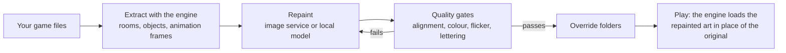

- **Extraction uses the engine itself**, so backgrounds, walk-behind masks, objects, animation frames and fonts come out exactly as the game draws them.
- **Animations are repainted as sheets**, several frames at once with an approved frame as an anchor, so characters keep the same face, colours and proportions from frame to frame instead of flickering.
- **Every result is checked automatically** before it's used:
  - alignment against the original, to within a game pixel;
  - colour drift against the original palette;
  - frame-to-frame flicker;
  - signs re-checked letter by letter, so lettering isn't invented.
  Anything that fails is redone or flagged for review.
- **The engine loads the repaints in place of the original art**: rooms (including widescreen extensions), characters, objects, inventory icons, cursors and replacement cutscene video. Walk-behinds, lighting changes and mirroring still work as the game intends.
- **For what can't be repainted asset by asset**, such as cutscene video, a small model trained on your own repaints restyles frames in real time. Cutscenes can also be repainted on key frames and carried through the motion.

### Where it stands
- Engine support for repainted rooms, characters, objects, interface, cursors and cutscene video: working, being tested.
- Repaint pipeline with quality gates and review tools: working, being tested.
- Local options (training your own models on a 16 GB consumer GPU): being evaluated.
- Next: packaging it all as a guided, resumable tool with documentation.

Screenshots from my own copy are in the [project update discussion](https://github.com/fleccy/scummvm-ai-upscale/discussions/2). No repainted art is stored in or distributed with this repository.

No release date yet. It will land when it's reliable. Star or watch the repository to follow along.

## Bring your own side art

The download contains nothing from the game. Beside the narrow (640-wide) rooms the game shows an ambient glow
taken from the picture's edges, or **side art**: painted scenery that continues the room to 16:9. Side art is
simply a folder of images, so it can come from anywhere: hand-painted, drawn over, AI-assisted, whatever you like.
The game uses it when it's there (F12 switches between side art, ambient glow and black bars).

**Format:** a folder `sides` with one PNG per room, named by room number (`0009.png`, `0057.png`, ...), 848 pixels
wide and as tall as the room (480 for most). The middle 640 columns are the room itself: the game always draws its
own picture there, so leave them black or keep a copy of the room as a reference. Paint the 104 columns on each
side; the 24 columns either side of each join are blended into the room's edge, so continue the scene across them.
Put the folder next to `install.cmd` before installing, or set `remaster_sides_path` in `scummvm.ini`. To find a
room's number and size, take a photo in game (Shift+F9) or run `generate_sides.cmd`, which saves every room's
background to `sides-work\room_NNNN.png` as a starting point.

**Generating it:** if you'd rather not paint, `generate_sides.cmd` (also offered by the installer) makes a full set
from your own copy with an AI model of your choice: Google Gemini through your own
[OpenRouter](https://openrouter.ai) account (about 4 USD for all 55 rooms; the room backgrounds are sent to
OpenRouter/Google), or Stable Diffusion XL on your NVIDIA graphics card (free and offline, about 11 GB of
downloads). It aligns each painted side with the room and blends the join, and
rejects a painting whose sides came back empty; anything it downloads stays in the install folder's `tools` folder, which it offers to remove when it's done.

**Sharing a set:** made something you're proud of? Post a link in the
[Discussions](../../discussions) with a screenshot or two. Packs are hosted by the people who make them; to share
only your own painting, `dists/remaster/sides/strip_middle.py` blanks the room in the middle of each image first.

**Cutscenes** work the same way, as `video-sides\<VIDEO>.sides` files (side strips per frame, see
[Cutscenes](#cutscenes)). `generate_cutscenes.cmd` makes them locally with the
[AI Remaster Pipeline](https://github.com/dtaddis/ai-remaster-pipeline) and Lightricks' LTX-2.3 video model. This is
the advanced option: it needs ARP installed (its own installer), an NVIDIA card with 16 GB of VRAM or more, 32 GB of
RAM, about 150 GB of disk space and many hours.

## Widescreen

Rooms wider than the screen show a real 16:9 view. Beside the many 640-wide rooms the game shows an ambient glow
taken from the picture's edges, or painted side art if you've generated it from your own copy (see
[Bring your own side art](#bring-your-own-side-art)); the sides fade out when a character walks off a
room's edge. Below: rooms with side art.

**Zoom to fill (experimental, no AI art):** F12 also offers to scale the 640-wide rooms up to the full screen
width instead. That shows a band three quarters of the room's height, which slides up and down to keep Guybrush,
the cursor and any text in view (push the cursor against the top or bottom edge to look there). *Zoom part-way*
scales only to 16:10 and keeps thin strips at the sides, so less is cut: the glow, or your side art if you have
some (only its inner 40 pixels show, the part closest to the real picture). Nothing is invented: every pixel is the
game's own picture. Cutscenes, wide rooms and the start menu are shown as usual.

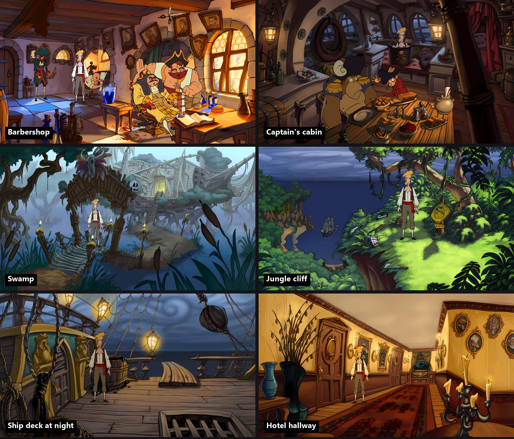

### Widescreen comparisons

The original game (640×480, 4:3, as ScummVM shows it) next to the same moment in scummvm-ai-upscale. Rooms
wider than the screen show more of the room (Puerto Pollo, the hotel, the carnival, where a character standing
just off the 4:3 picture comes into view); narrower rooms get side art if you generate it (the cliff top, the lava
bridge).

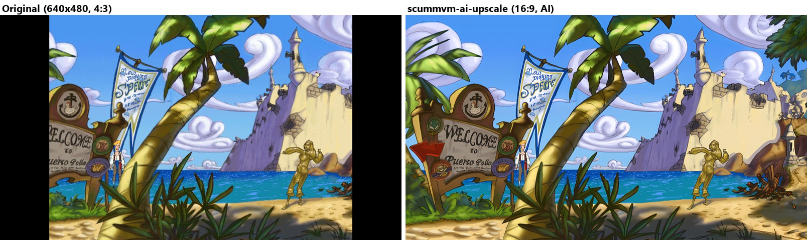
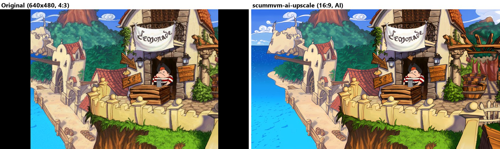
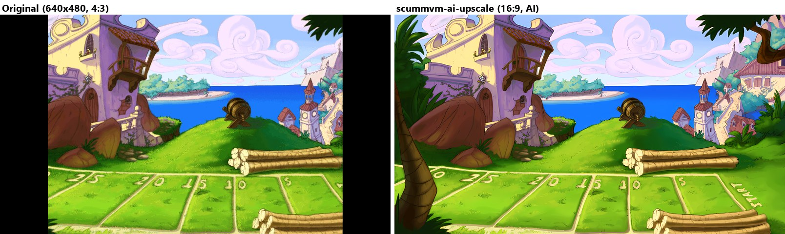
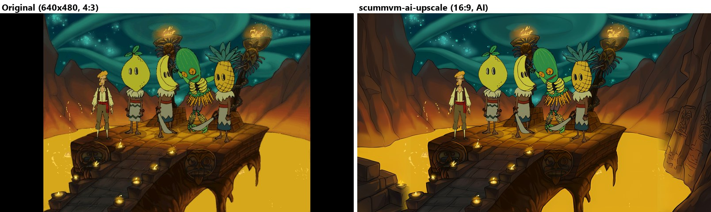
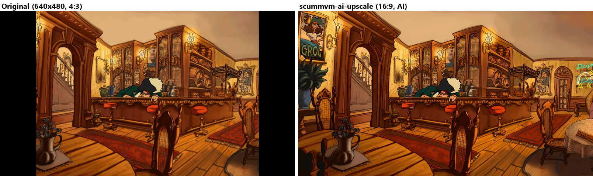
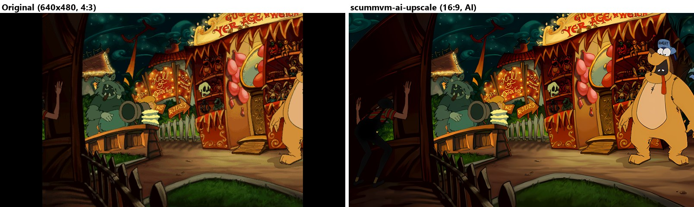

## HD characters

Characters are drawn from their full-size sprites (AI-upscaled once and cached) instead of the shrunken game
sprite, so faces and hands keep their detail when characters stand further away. Each sprite appears at once with
the real-time AI's version and is then refined in the background by the heavier HD-background model.

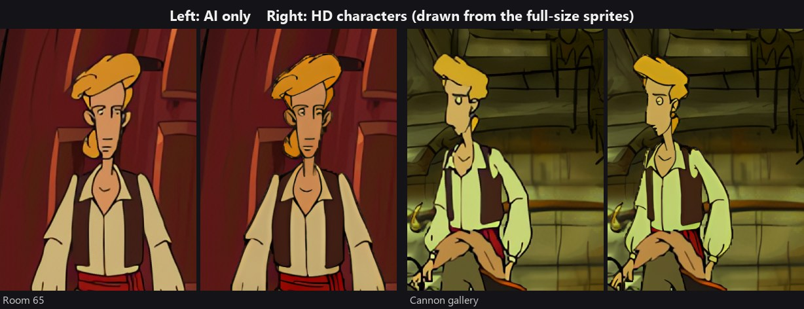

## HD backgrounds

Each room's background is upscaled once more with a heavier model, too slow for every frame, and used wherever
the screen shows untouched background. Ink lines and painted detail come out cleaner; characters, objects that
changed and the interface keep the real-time AI. Switch it off in Options > Game (*HD backgrounds*).

Two models are offered (F9 menu, *HD background model*; `remaster_bg_net`), and each game has its own default:

| HD background model | What it is | Per room on an RTX 5080 | Default in |
|---|---|---|---|
| **4x UltraSharpV2** (`ultrasharpv2`) | A large DAT2 transformer: keeps painted texture, brush strokes and architecture; dithering stays visible as fine grain. Needs DirectML or TensorRT (Windows, any DirectX 12 GPU) | 2-3 s for a 320 x 200 room, about 9 s for a wide Monkey Island 3 room (DirectML; TensorRT about 3 s) | The Dig |
| **Real-ESRGAN x4plus anime** (`x4anime`) | Clean anime-style lines; flattens fine texture. Runs everywhere (Vulkan), and stands in where UltraSharpV2 cannot run (e.g. Linux) | well under a second | Monkey Island 3 and the other games |

Like a shader cache in other games, the results are kept on disk (about 2.5 MB per room). The installer offers
to prepare all rooms up front (a few minutes; or run `prewarm.ps1` in the install folder later), so every room
is HD from its first frame. Otherwise a room is prepared on a worker thread the first time you enter it and
fades to HD within a second or two.

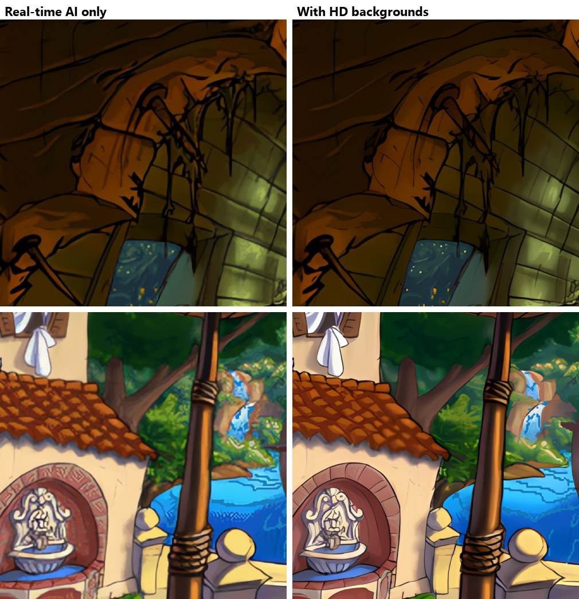

## Readable subtitles

Subtitles, dialogue choices and cutscene subtitles are not run through the AI. The game's own letters are laid
over the finished picture (in AI HD with smooth, anti-aliased outlines; in the pixel modes as exact pixel blocks;
*Smooth subtitles in AI HD* in Options > Game switches AI HD to the pixel letters too), and the picture underneath
is upscaled as if the text weren't there, so there's no smeared copy of the letters around them. This also applies in the retro display modes and
under CRT scanlines. Below: the same line before and after this change, as 2× close-ups of the output (the VGA
picture also shows the corrected palette colours, see [Retro modes](#retro-modes)).

**Subtitle background** (F9 settings menu, off by default): a soft, half-transparent dark box behind subtitles and
object names, for easier reading on busy or bright scenes.

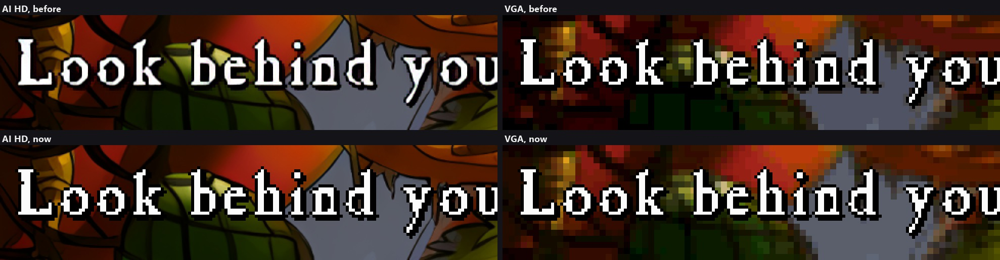

## Choose your upscaler (Ctrl+F9)

Several upscalers are built in. By default the game uses **Auto**: on its first start it times the upscalers this
PC has (about a second, once) and keeps the fastest; it measures again when the graphics card or the version
changes. On an RTX 5080 that is DirectML, about a third faster than the standard one, or TensorRT once it has been
used (Auto never starts TensorRT's first-time engine build of a few minutes by itself). **Ctrl+F9** or the settings
menu (F9) picks one yourself, so you can compare them on any scene; that choice is remembered. All AI choices use the same Real-ESRGAN networks (with identical weights);
they differ in which engine runs them on your GPU, and in the network size.

| Upscaler | What it is | Whole frame on an RTX 5080 |
|---|---|---|
| **Real-ESRGAN AI (ncnn)** | The standard one. Vulkan, so any NVIDIA, AMD or Intel GPU | 21-27 ms |
| **Real-ESRGAN AI (DirectML)** | The same network through Microsoft's DirectML in fp16 (tensor cores on RTX cards). Any DirectX 12 GPU | 13-14 ms |
| **Ultra AI (DirectML)** | The heavy `x4plus-anime` network (the one behind the HD backgrounds) live, for everything that moves. Crisper outlines and textures; in rooms where it can't keep up it steps down to the standard network | 60-70 ms |
| **Real-ESRGAN AI (TensorRT)** / **Ultra AI (TensorRT)** | NVIDIA's own AI engine, the fastest on NVIDIA cards. Optional download in the installer (about 1.5 GB); the first time you choose it, it prepares its engines for your card in the background (about a minute per network; the standard AI is used meanwhile) | 8 ms / 61 ms |
| **AMD FSR 1 (no AI)** | AMD FidelityFX Super Resolution 1 (edge-adaptive upscaling + sharpening), for comparison. The AI-made HD backgrounds step aside while it is shown | about 3 ms |

Most frames only re-upscale the parts that changed, so the usual cost is far lower than a whole frame (town:
about 5-6 ms with the standard network, 25 ms with Ultra).

With HD backgrounds and HD characters on (the default), the heavy network already paints the backgrounds and
refines every character, so in rooms Ultra only changes moving scenery (water, fire, objects). Where it shows is
**cutscenes**: with **Ultra AI (TensorRT)** they are upscaled by the heavy network too, in real time on an RTX
5080 (about 45 ms per frame), with visibly finer lines. The standard AI is the recommended choice, and
TensorRT or DirectML simply run it faster.

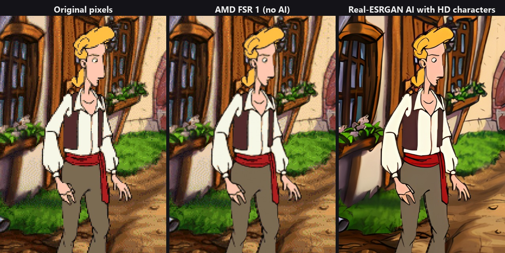

### AI model (F9 menu, `remaster_ai_net`)

The network behind the AI picture can be swapped too. The standard one is the default except in The Dig and Sam & Max,
which start with AniSD; the others are alternatives to compare, each with its own look. The standard model,
Futsuu-Anime, AniScale2S and AniSD also run on DirectML and TensorRT; the others run on the Vulkan (ncnn) upscaler
only (chosen together with DirectML or TensorRT, such a model runs on ncnn instead, and Auto simply uses ncnn).

| AI model | What it is | Whole frame on an RTX 5080 |
|---|---|---|
| **Real-ESRGAN animevideo v3** (`default`) | The standard network, smooth and clean | about 24 ms (DirectML 13) |
| **2x Futsuu-Anime** (`futsuu`) | A 2x anime network: much less speckle in dithered areas than the standard one, colours unchanged; resized to the display scale | about 23 ms (DirectML 10) |
| **Real-CUGAN 3x conservative** (`cugan`) | Sharper outlines, keeps more of the painted texture. It looks at the whole picture at once, so it always upscales whole frames (no partial updates, no tile cache): heavier while things move | about 50 ms |
| **2x StarSample V2.0 Lite** (`starsample`) | Clean, flat "cartoon" look: dithering disappears into smooth paint; small, busy sprites can lose detail | about 26 ms |
| **ArtCNN C4F32** (`artcnn`) | The lightest: sharpens brightness only (colour is resized smoothly), close to the original pixels, keeps dithering | about 10 ms |
| **2x AniScale2S Compact** (`aniscale2s`) | A 2x anime network with crisp lines; keeps more of small faces, but dithered costumes can turn to speckle | about 23 ms (DirectML 10) |
| **2x AniSD Compact** (`anisd`) | A 2x network for low-resolution anime: soft and close to the original art; the default in The Dig and Sam & Max | about 23 ms (DirectML 10) |

Partial updates and the tile cache keep the usual cost in play far below a whole frame for every model except
Real-CUGAN.

## Photo mode (Shift+F9)

Saves the scene twice in a `photos` folder next to the saves: exactly as shown (side art, HD backgrounds and
characters, no cursor), and as a poster upscaled 4x by the heavy network (3392x1920 in wide rooms, without
subtitles, made on a worker thread while you keep playing). Below: a poster scaled down, and a 1:1 crop of it.

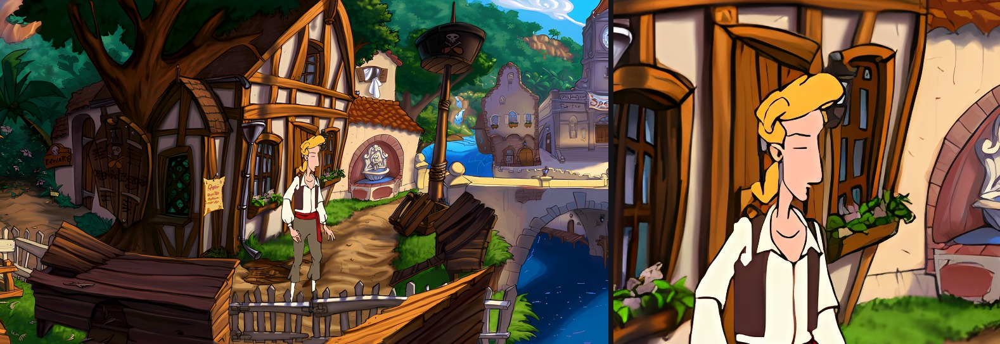

## The Dig (experimental)

The Dig (1995, SCUMM v7, the engine generation just before Monkey Island 3) shares most of the renderer, so it
gets the same treatment: every frame upscaled 4x live (320 x 200 -> 1280 x 800), readable text, the cutscenes
(steadied the same way), and **true widescreen**: 424 x 200 instead of 320 x 200, so wide rooms show more of the
room and narrow ones are centred with the glow at the sides. The picture keeps the original's tall pixels (it
was drawn for 4:3 monitors), so widescreen comes out exactly 16:9.

Differences from Monkey Island 3:

- HD characters are off by default: The Dig's sprites are small and the heavy network flattens their faces;
  the real-time pass over the whole frame keeps them. F9 turns them on.
- No side art and no zoom to fill.
- Three rooms hold several scenes side by side; they are shown one picture at a time, as in the original.

Status: every room loads and shows correctly in an automated sweep, and the cutscenes play; the game has not
been played through with the remaster yet. You need your own copy (Steam: `The Dig\The Dig.exe` holds the
game's index, so point ScummVM at that folder, not at `DIG`).

## Indiana Jones (experimental)

**Fate of Atlantis** (1992, SCUMM v5) and **The Last Crusade** (1989, SCUMM v3, the 256-colour version) run with
the real-time upscaling too: the scene 4x, the verbs, inventory, sentence line and dialogue as the games' own crisp
pixel letters laid over it, and **true widescreen** (424 x 200, 16:9 with the tall pixels): wide rooms show more of
the room, narrow ones are centred with the glow at the sides, and the verb panel keeps its original size, centred
under the picture (clicks land where they should).

- HD characters are off (the sprites are small; the real-time pass keeps their faces), and Last Crusade has the
  grain guard off (its art is dithered nearly everywhere and the AI keeps it sharp).
- Fate of Atlantis's binocular view is shown as the original picture only (a wider view would reveal what its mask
  hides).
- Status: rooms load and show correctly in automated sweeps; neither game has been played through with the
  remaster yet. Characters that the original keeps just outside the old screen edge until they walk in may be
  visible early in some rooms.

Steam: point ScummVM (or the installer) at the game's folder; the index is inside the game's `.exe` there.

## Loom and Sam & Max (experimental)

**Loom** (1990, the VGA CD talkie version, SCUMM v4) and **Sam & Max Hit the Road** (1993, the CD version, SCUMM v6)
get the same real-time upscaling: the scene 4x, readable text and **true widescreen** (424 x 200, 16:9 with the tall
pixels), with narrow rooms centred and the glow at the sides.

- **Loom:** the musical staff (the distaff) is laid over the AI picture as the original's pixel art, so its thin lines
  and notes stay exact. Loom uses F9 itself (text on screen on/off), so the remaster settings menu is on **Alt+F9**
  there. Only the VGA CD version is remastered; the EGA, FM Towns, PC Engine and Mac versions play as in ScummVM.
  Speech and music come from the CD audio track (`track1`), as in ScummVM.
- **Sam & Max:** the real-time model defaults to AniSD, which keeps Sam's and Max's faces. The inventory is shown over
  the original 4:3 picture, centred. A few rooms whose next scene sits right beside the shown one (the coin-op
  viewers, the dress-up pages, the title strip) are shown one picture at a time.
- Both: HD characters and the grain guard are off by default (F9 turns them on).
- The installer finds and sets up both (`-Games loom,samnmax`, or `-LoomPath` / `-SamnmaxPath` for the folders). Loom
  needs the VGA CD version's files (`000.LFL`, `DISK01.LEC`) and its CD audio track ripped next to them as FLAC
  (`track1.flac`); the installer says so when the track is missing. Steam's Loom (`Loom.exe` with the same
  data) is recognised too but hasn't been tested yet. Sam & Max needs the CD version (`SAMNMAX.000`, `SAMNMAX.001`).
- Status: rooms load and show correctly in automated sweeps (4:3 and widescreen); neither game has been played
  through with the remaster yet. Reports are welcome.

## Display options

Every option can be changed during play and is remembered. They are also available in the in-game options
(Ctrl+F5 > Options > Game).

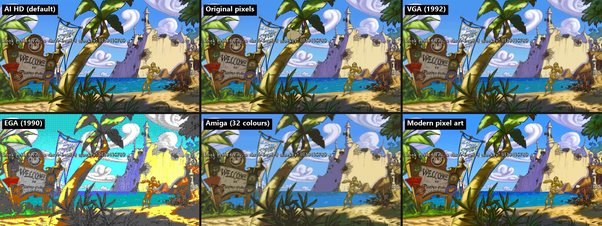

**F9** (or the controller's Back button) opens the remaster settings: the look, the upscaler, AI strength, HD
characters and backgrounds, smooth text, grain guard, CRT scanlines, performance mode, what fills the sides of
narrow rooms and smooth scrolling, all in one place. The keys below switch the same things directly. The menu shows
only what applies to the game you play: The Dig, the Indiana Jones games, Loom and Sam & Max have no side art or zoom to fill and
keep AI HD and the original pixels as their looks (the retro looks are made at half a high-resolution game's size),
the Indiana Jones games offer sharp text instead of smooth text and no smooth scrolling. OK saves only what you
changed, so the other settings keep following each game's defaults.

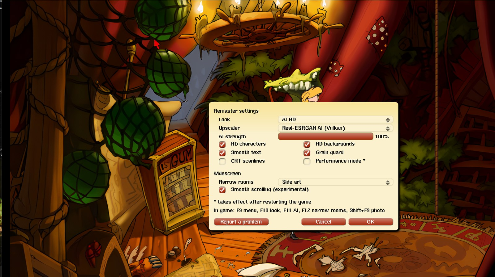

| Key | Switch |
|---|---|
| **F9** | Remaster settings menu |
| **F10** | Display mode: AI HD, Original, VGA (1992), EGA (1990), Amiga (32 colours), Modern pixel art (an experimental *Classic 320×200* mode is set in `scummvm.ini`, see [Retro modes](#retro-modes)) |
| **Ctrl+F10** | CRT scanlines over any mode |
| **F11** | AI upscaling on/off |
| **Ctrl+F9** | Upscaler: ncnn / DirectML / Ultra / TensorRT / AMD FSR (see above) |
| **Shift+F9** | Photo mode: saves the scene as shown and a poster-size 4x version (heavy model) in the `photos` folder |
| **Ctrl+Shift+F9** | Smooth scrolling (experimental): the camera glides on every screen refresh instead of stepping at the game's 12 frames per second; the character it follows and any text stay steady |
| **Shift+F11** | Grain guard on/off |
| **F12** | Widescreen sides: painted side art, ambient glow, zoom to fill, zoom part-way or black bars |
| **Ctrl+F12** | Report a problem: saves screenshots and details, opens a pre-filled GitHub issue |
| **Ctrl+F11** | Comparison slider: current picture on the left; on the right the original pixels, then (press again) AMD FSR, then the standard AI; hold **Ctrl** and move the mouse to drag the divider |
| **Ctrl + / Ctrl −** or **Ctrl + mouse wheel** | AI strength in 10 % steps (100 % = full AI, lower blends towards a plain smooth upscale) |

## Screenshots

The same frame, split down the middle. Left: the original 640×480 game as ScummVM shows it (4:3, black bars).
Right: scummvm-ai-upscale (16:9, AI, HD backgrounds and characters, side art).

| | |
|---|---|
| 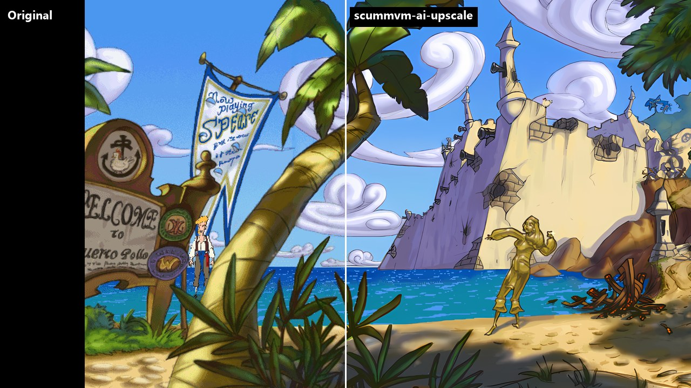 | 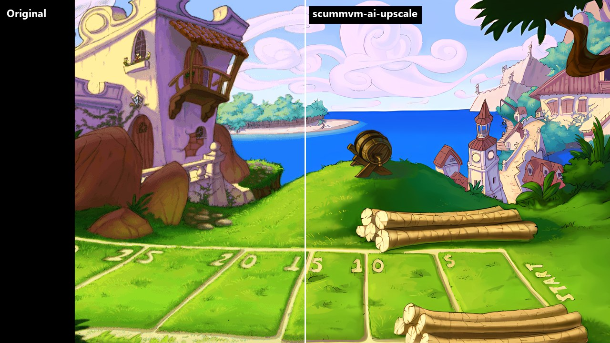 |
| 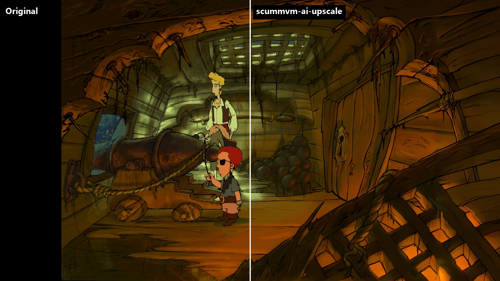 | 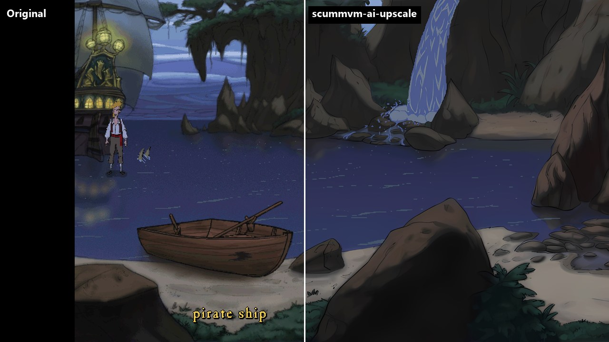 |
| 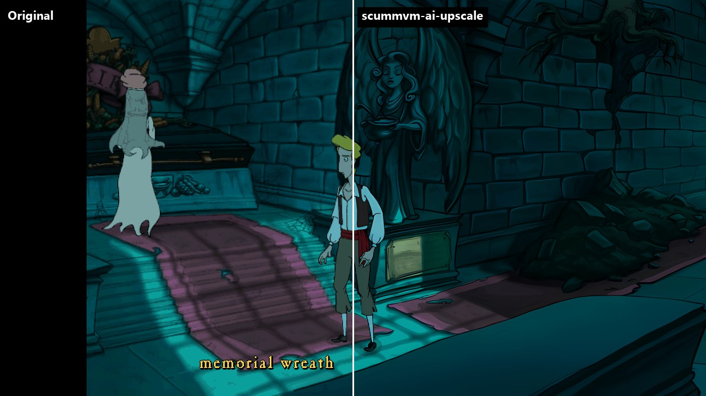 | 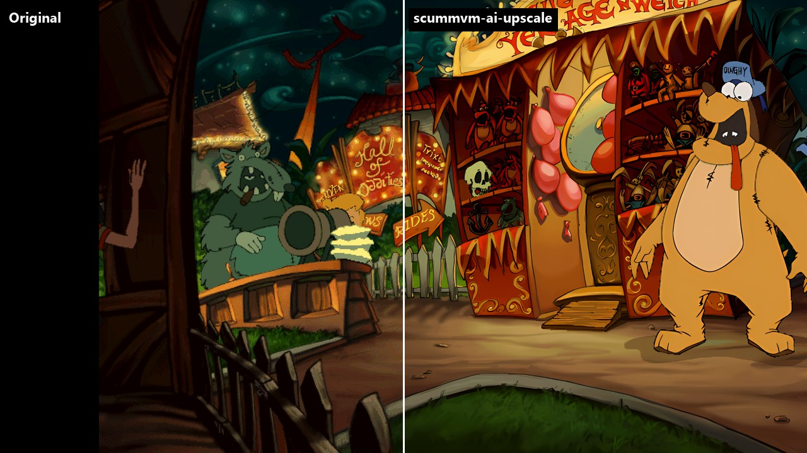 |

Close-up at the final 3× size (1:1 pixels of the 2544×1440 output):

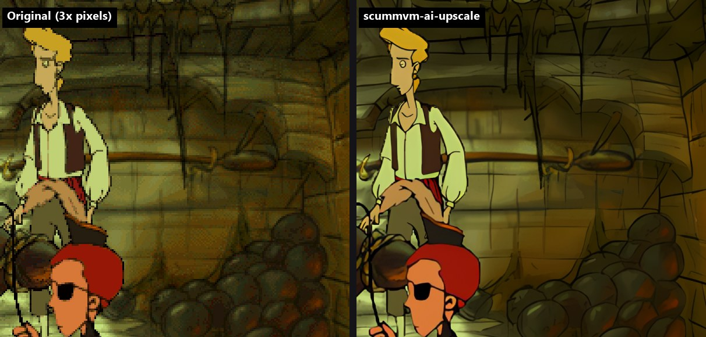

Display modes, as 1:1 close-ups of the output: AI HD, the original pixels, and calculated "demaster" looks (F10
cycles them; the experimental Classic mode is set in `scummvm.ini`):

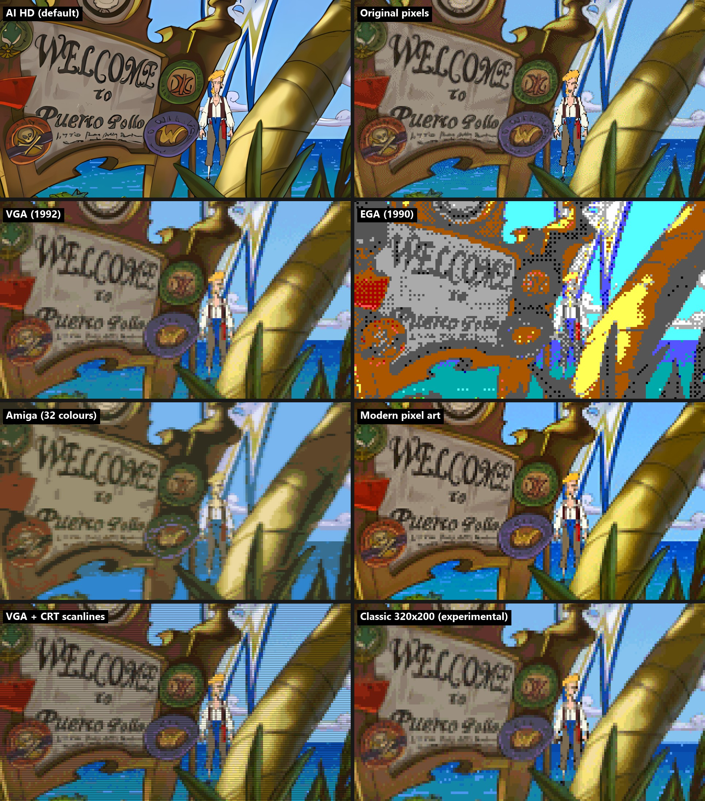

Ambient side-panel mode (`remaster_widescreen=ambient`):

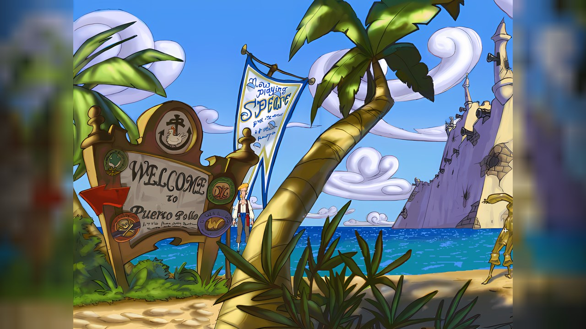

## Install (Windows)

1. Install the game(s) from Steam or GOG: The Curse of Monkey Island, and if you like The Dig, the two Indiana
   Jones games, Loom (VGA CD version) and Sam & Max Hit the Road (CD version) (experimental).
2. Download the latest `scummvm-ai-upscale-…-windows-x64.zip` from [Releases](../../releases) and extract it.
3. Double-click **`install.cmd`**.
   It finds your Steam or GOG copies (or asks for the folders), lets you tick the games to set up, installs to
   `%LOCALAPPDATA%\ScummVM-AI-Upscale` and creates a desktop shortcut per game. Your game files are only read, never changed. It asks how you want to play:
   **Original (no AI)**, **Enhanced** (recommended) or **Experimental**. That's only a starting point: every
   setting can be changed in game (F10, F11, F12, Ctrl+F5). *Original* is for players who want no AI at all, or
   an older or low-power PC: the 1997 picture, plus the extras that need no AI (controller support, photo mode,
   the VGA/EGA/Amiga looks and CRT scanlines).

   | | Original (no AI) | Enhanced | Experimental |
   |---|---|---|---|
   | Picture | the original pixels | redrawn sharp by AI on your graphics card | as Enhanced |
   | Screen | 4:3, as in 1997 | 16:9: wide rooms show more of the room | as Enhanced |
   | Beside narrow rooms | - | a soft glow taken from the picture | painted scenery, if you make or generate it |
   | Characters and backgrounds | as in the game | extra detail (HD characters and backgrounds) | as Enhanced |
   | Cutscenes | as in the game | upscaled, with black bars | full width, if you generate them |
   | Camera | the game's steps | the game's steps | smooth scrolling (experimental) |

   The table describes The Curse of Monkey Island; the other games get the same picture and screen choices
   (painted scenery, widened cutscenes and smooth scrolling are Monkey Island only). Side art or widened cutscenes
   you've generated yourself (folders `sides` and `video-sides` next to `install.cmd`) are installed too. On NVIDIA cards it also offers the optional TensorRT upscaler
   (downloaded from Microsoft's and NVIDIA's official package pages, about 1.5 GB, under NVIDIA's licences).
4. Start a game from its desktop shortcut, e.g. **The Curse of Monkey Island (AI upscaling)**.

**"Windows protected your PC"?** This hobby project isn't code-signed, so Windows asks once when you start
`install.cmd` from the download: click *More info* > *Run anyway* if you trust it (the full source and the build
scripts are in this repository). The installer then removes the download mark from the files it installed,
as setup programs do, so the game itself starts without a second prompt.

**Requirements:** 64-bit Windows 10/11 and a GPU with an up-to-date Vulkan driver (any recent NVIDIA,
AMD or Intel graphics). On an RTX 5080 the AI takes about 2-10 ms per frame (only changed areas are
re-upscaled). On slower GPUs, rooms that are too heavy automatically drop optional passes; you can also switch
off HD characters and HD backgrounds or use the performance mode (Ctrl+F5 > Options > Game). Without Vulkan the
game still runs, just without AI upscaling.

<details>
<summary>Manual installation / other options</summary>

- Run `install.ps1 -GamePath "D:\Games\Curse of Monkey Island"` if your copy isn't detected (the folder
  must contain `COMI.LA0` and `RESOURCE\`); `-DigPath`, `-AtlantisPath`, `-Indy3Path`, `-LoomPath` and `-SamnmaxPath`
  do the same for the other games, and `-Games comi,dig,atlantis,indy3,loom,samnmax` chooses which to set up without
  asking.
- `install.ps1 -Preset original|enhanced|experimental` applies a preset (also to an existing install, whose
  settings are otherwise kept).
- `install.ps1 -InstallDir <folder>` installs somewhere else; `-NoShortcuts` skips the shortcuts;
  `-TensorRT yes|no` answers that question in advance.
- Running the installer again updates the program and keeps your settings and saves.
- To update, download the new release and run `install.cmd` again (the game tells you when there is one).
- To uninstall, delete `%LOCALAPPDATA%\ScummVM-AI-Upscale` and the shortcuts.

</details>

## Install (Linux / Steam Deck, untested)

A Linux x86_64 build (`scummvm-ai-upscale-…-linux-x86_64.tar.gz`) is on the release page: extract it and run
`play.sh`, which finds your Steam or GOG copy.
Details, Steam Deck tips and options are in its `README.txt`
([dists/remaster/README-linux.txt](dists/remaster/README-linux.txt)). The Linux build has only been run under
WSL so far, where no GPU display is available, so the upscaling hasn't been tested on real Linux hardware or a
Steam Deck yet. Reports are welcome.

## Keys and settings

| Key | |
|---|---|
| **F9** | Remaster settings menu (everything below in one place) |
| **F10** | Cycle display mode: AI HD, Original, VGA (1992), EGA (1990), Amiga (32 colours), Modern pixel art |
| **Ctrl+F10** | CRT scanlines on/off (works with every mode) |
| **F11** | AI upscaling on/off |
| **Ctrl+F9** | Upscaler: ncnn / DirectML / Ultra (DirectML) / TensorRT / Ultra (TensorRT) / AMD FSR |
| **Shift+F9** | Photo mode (`photos` folder next to the saves): the scene as shown, plus a 4x poster (3392x1920 in wide rooms) |
| **Ctrl+Shift+F9** | Smooth scrolling on/off (experimental) |
| **Shift+F11** | Grain guard on/off |
| **Ctrl+F11** | Comparison slider (original pixels / AMD FSR / standard AI on the right) |
| **Ctrl + / Ctrl −** | AI strength |
| **F12** | Side panels: side art (if generated) / ambient glow / zoom to fill / zoom part-way / black |
| Alt+Enter | Window / fullscreen (resizable window; the Start menu also has a windowed shortcut) |
| Ctrl+F5 | ScummVM menu (save, load, options) |

**Controller** (Xbox/PlayStation layout; remappable in Options > Keymaps):

| Button | Action |
|---|---|
| Right stick | Walk Guybrush directly (slides along obstacles) |
| Left stick | Cursor (RB = slow cursor) |
| D-pad left/right | Jump the cursor to the previous/next hotspot (objects, people, exits) |
| A | Click; hold for the verb coin |
| B | Inventory |
| X / Y | Skip line / skip cutscene |
| LB / Start | Game menu / ScummVM menu |
| D-pad up / down | Display mode / side panels |
| RT / LT | AI on/off / side panels |
| L3 / R3 | CRT scanlines / report a problem |
| Back / View | Remaster settings menu |

Settings in `scummvm.ini` (install folder):

| Key | Values |
|---|---|
| `remaster_ai_model` | path to the ncnn model, without extension (the ONNX models for the other upscalers sit next to it) |
| `remaster_ai_backend` | `auto` (default: the fastest here, measured once), `ncnn`, `dml`, `dml-ultra`, `trt`, `trt-ultra` or `fsr` (Ctrl+F9 and F9 change it) |
| `remaster_ai_net` | AI model for the live picture: `default` (Real-ESRGAN animevideo v3), `futsuu` (2x Futsuu-Anime), `cugan` (Real-CUGAN 3x conservative), `starsample` (2x StarSample V2.0 Lite), `artcnn` (ArtCNN C4F32), `aniscale2s` (2x AniScale2S Compact) or `anisd` (2x AniSD Compact); files next to `remaster_ai_model`. Unset: the game's own default (The Dig and Sam & Max: `anisd`, the others `default`). `default`, `futsuu`, `aniscale2s` and `anisd` run on DirectML / TensorRT, the others on ncnn (F9 changes it; see [AI model](#ai-model-f9-menu-remaster_ai_net)) |
| `remaster_hd_actor_refine` | `true` (default): refine HD characters with the heavy network in the background |
| `remaster_hd_actor_cache_mb` | memory for HD characters, default `768` (least recently used are dropped first) |
| `remaster_photo_dir` | folder for photo mode (default: `photos` next to the saves folder) |
| `remaster_smooth_scroll` | `false` (default) / `true`: smooth scrolling (Ctrl+Shift+F9), experimental |
| `remaster_governor` | `true` (default): in rooms that are too heavy for the GPU, first step Ultra down to the standard network, then drop optional passes; `false` keeps everything |
| `remaster_ai_scale` | `auto` (default: 4 on 4K screens, 3 on 1440p, 2 on 1080p and smaller), or `2`, `3`, `4` (the AI models are x3; x2 and x4 are resized from their output) |
| `remaster_sides_path` | folder with AI-extended side art for narrow rooms (see [dists/remaster/sides](dists/remaster/sides/README.md)) |
| `remaster_widescreen` | `wide` (default): true 16:9 view (848×480 game screen); `ambient`: 4:3 picture with ambient side panels; remove for plain 4:3 |
| `remaster_zoom` | `false` (default) / `true`: zoom narrow rooms to fill the width (experimental; also F12 and Options > Game) |
| `remaster_zoom_part` | `false` (default) / `true`: with `remaster_zoom`, zoom only to 16:10 |
| `remaster_zoom_skip_rooms` | rooms never zoomed; default `87` (the difficulty sign at the start) |
| `remaster_grain_guard` | `true` (default) / `false` |
| `remaster_performance` | `false` (default) / `true`: for older GPUs: 2x output, no HD characters, no grain guard, and the lightest AI model (ArtCNN, made for 2x) unless `remaster_ai_net` names another; about half the AI time of the standard model |
| `remaster_ai_incremental` | `true` (default): only re-upscale the part of the frame that changed |
| `remaster_ai_tile_cache_mb` | `256` (default): memory for recently upscaled tiles. Animation that repeats (colour-cycled water, fire, looping scenery) is then upscaled once per distinct picture instead of every frame: in the busiest rooms several times less AI work, with an identical picture. `0` switches it off |
| `remaster_hd_actor_async` | `true` (default) / `false`: new character animation frames are made in HD in the background; until then the real-time AI picture shows them (instead of a few ms on the frame each) |
| `remaster_present_rect` | `true` (default) / `false`: send the screen only the part of the picture that changed (saves about 1 ms a frame in quiet scenes; whole frames while most of the picture moves) |
| `remaster_video_temporal` | `true` (default) / `false`: in cutscenes, blend the AI picture with the previous frame where the video's pixels barely changed: about half the shimmer of fine detail, moving parts unchanged |
| `remaster_subtitle_box` | `false` (default) / `true`: a soft dark box behind subtitles and object names (F9 menu) |
| `remaster_ai_cursor` | `true` (default): AI-upscale the cursor and held inventory items (larger cursors only) |
| `remaster_live_edge_rooms` | rooms whose animated edges (water) continue live into the side art; default `11,13` (ship's side, island map) |
| `remaster_edge_guard` | `true` (default): fade the side art when something is cut at a narrow room's edge (mainly needed in retro modes / without HD characters) |
| `remaster_update_check` | `true` (default): once a day, ask GitHub whether a newer release exists and say so in game (nothing is downloaded) |
| `remaster_ai_strength` | `0`-`100` (default `100`): how much of the AI is used |
| `remaster_hd_actors` | `true` (default): characters drawn from their full-size sprites, AI-upscaled and cached |
| `remaster_hd_backgrounds` | `true` (default): room backgrounds upscaled again with a heavier model on a worker thread |
| `remaster_bg_net` | HD background model: `ultrasharpv2` (4x UltraSharpV2, DirectML / TensorRT only) or `x4anime` (Real-ESRGAN x4plus anime); unset: the game's default (The Dig `ultrasharpv2`, the others `x4anime`). Where UltraSharpV2 cannot run, x4plus anime is used. With TensorRT as the upscaler, UltraSharpV2 runs on TensorRT too (DirectML while its engine is built the first time) |
| `remaster_bg_model` | a model of your own for HD backgrounds (ncnn `.param`/`.bin` base path; replaces `remaster_bg_net`) |
| `remaster_bg_pause` | UltraSharpV2 only: rest between its tiles, in percent of a tile's time (default `50`), so the real-time AI keeps the GPU most of the time |
| `remaster_hd_actor_net` | model that refines HD characters: `x4anime` (default), `background` (the HD background model) or a real-time model's id (e.g. `anisd`) |
| `remaster_bg_scale` | scale of that model, default `4` (its output is resampled to the game's scale) |
| `remaster_bg_cache` | folder for the HD background cache (default: `hd-cache` in the install folder); `remaster_bg_cache_enabled=false` disables it |
| `remaster_bg_prewarm` | `true`: quit once the current room's HD background is ready (used by `prewarm.ps1`) |
| `remaster_video_sides_path` | folder with widened-cutscene side strips (`<VIDEO>.sides`, see [dists/remaster/video-sides](dists/remaster/video-sides/README.md)); without it cutscenes keep black bars |
| `remaster_video_sides` | `off` to ignore the side strips (F12 also switches them, live) |
| `remaster_smooth_text` | `true` (default): in AI HD, text has smooth anti-aliased outlines; `false`: the game's crisp pixel letters (the retro modes always use those). Also in Options > Game |
| `remaster_sharp_text` | `false` (default) / `true`: text with Scale2x/3x edges instead (all modes) |
| `remaster_display_mode` | `0` AI HD, `1` original, `2` VGA, `3` EGA, `4` Amiga, `5` modern pixel art, `6` Classic 320×200 (experimental, not in the F10 cycle) |
| `remaster_crt` | `true` / `false` |
| `remaster_ai_off_rooms` | comma-separated room numbers where the AI is skipped, e.g. `25,60` |

## Reporting problems

Press **Ctrl+F12** in game. The game saves what is on screen (`screen.png`), the unprocessed game frame
(`original-frame.png`) and your settings to the `reports` folder in the install folder, opens that folder and
opens a new GitHub issue in your browser with the details filled in. Describe what looks wrong and drag
`screen.png` into the issue. (A GitHub account is needed to post; nothing is sent without you.)

## Known issues

- Grainy, dithered textures (for example the swirly background of the banjo duel) would come out speckled,
  because the network sharpens the grain. The **grain guard** (on by default, Shift+F11) detects such areas
  each frame and uses a softened normal upscale there, while characters keep the AI.
- Very heavy scenes (the cannon battle at the start: the whole picture is animated water) automatically refresh the
  AI picture on every other frame and, if that is not enough, drop HD backgrounds and finally HD characters, so the
  game keeps its speed (`remaster_governor=false` keeps everything).
- Windowed mode at sizes other than 3× scales the upscaled image again (smoothly, so pixel edges soften a
  little); fullscreen on 1440p fits exactly. The scale follows the screen by default (`remaster_ai_scale=auto`):
  x2 on 1080p, x3 on 1440p, x4 on 4K.
- Smooth scrolling and the Classic 320×200 display mode are experimental.

## How it works

The games run on ScummVM's unmodified SCUMM interpreters (v8 for Monkey Island 3, v7 for The Dig, v5 for Fate
of Atlantis, v3 for Last Crusade): scripts, timing, the camera and input logic are the original games'. The fork
changes what happens to finished frames before they reach the screen, plus a few hooks so the renderer knows what
each pixel is. Most of it lives in `engines/scumm/remaster_render.cpp` (renderer) and
`engines/scumm/remaster_ai.cpp` (neural network runtime).

**Per-game profiles** (`engines/scumm/remaster_game.cpp`) say what each game supports and how it starts: true
widescreen, controller walking, HD characters, sharp or smooth text, the grain guard, zoom to fill, whether the
wider view is kept within the original camera's limits, the default real-time AI model and HD background model,
and room lists (rooms holding several scenes side by side
are shown one picture at a time; Monkey Island 3's side-art rooms). A game without a profile runs as plain
ScummVM. The diagram and numbers below are for Monkey Island 3 (640 x 480, 3x); the 320 x 200 games run at 4x
(1696 x 800 in widescreen), keep their tall pixels when shown (16:9 on screen), and the classic games (v3, v5)
keep their verb panel at its original width, centred under the widened room.

### Frame pipeline

```
game draws its 8-bit frame (848x480 in widescreen)          per-pixel bookkeeping recorded while drawing:
  |                                                          - which pixels are plain room background
  v                                                          - which belong to which character (costume)
palette -> 32-bit frame                                      - which are text, shadow, UI
  |                                                          - for text: the scene pixel under each letter
  +-- text taken out (each letter pixel -> the scene under it)
  +-- real-time AI upscale x3 (only the part that changed)   or a retro mode (VGA, EGA, Amiga, ...)
  +-- grain guard (softens dithered areas the AI would turn into speckle)
  +-- HD backgrounds (heavier model, made on a worker thread)
  +-- HD characters (full-size sprites, upscaled once, cached)
  +-- optional CRT scanlines / comparison slider
  +-- text laid back over the result in the game's own font, pixel-exact
  v
centre narrow rooms, fill the sides (painted art / live edges / ambient), present at 2544x1440
```

### Real-time AI upscaling

- Model: [Real-ESRGAN](https://github.com/xinntao/Real-ESRGAN)'s `realesr-animevideov3` (a small, fast
  network made for anime-style video) at 3×, run through [ncnn](https://github.com/Tencent/ncnn) on the GPU
  with Vulkan, so it works on NVIDIA, AMD and Intel. Weights and activations are stored as fp16, arithmetic is
  fp32 (fp16 arithmetic shifted colours slightly).
- **Incremental:** an adventure game frame rarely changes everywhere. Each frame is compared with the previous
  one; only the changed rectangle, grown by 16 px (the network's influence radius) plus 20 px of context, is run
  through the network and pasted into the previous output. A full refresh follows a few frames after large
  changes, so no residue can build up. Typical cost on an RTX 5080: 2-13 ms per frame.
- Changed areas are tracked on a 32 px grid and upscaled as separate rectangles, so two people walking on
  opposite sides of a room don't force one huge box. When the camera scrolls, the previous upscaled picture is
  shifted and only the newly shown strip (plus the old edge, which was upscaled without its right-hand context)
  goes through the network.
- The network's output is converted to RGBA bytes by a small compute shader of our own on the GPU, so 4 instead
  of 12 bytes per pixel come back and the CPU has nothing to convert (bit-identical to ncnn's own conversion).
- The cursor (and items held as the cursor) is upscaled with the same network; small cursors use Scale3x.
- The networks work at 3×; at the 2× and 4× output scales (`remaster_ai_scale`) their output is resized
  (area-averaged down, linearly up).
- The other AI models (`remaster_ai_net`): a network of another scale runs at its own scale and its output is
  resized bicubically on the GPU (an ncnn Interp layer before the colour conversion; on the CPU a whole frame took
  10-12 ms). `dists/remaster/convert_models.py` makes their ncnn models: Futsuu-Anime from its PyTorch state dict
  (read with `weights_only`), StarSample and ArtCNN from their ONNX graphs. ArtCNN works on luma only, so its ncnn
  graph turns RGB into BT.709 Y for the network, resizes Cb and Cr bicubically beside it and converts back. For
  DirectML / TensorRT, `ncnn2onnx.py x2to3` adds a fixed bicubic 2 -> 3 enlargement (a strided convolution +
  DepthToSpace) to Futsuu-Anime, so its ONNX model is x3 like the standard one. In-engine output matches the
  networks run in PyTorch to within rounding (mean 0.5/255). Real-CUGAN works at 3× with unpadded convolutions: the input gets 14 px of
  repeated edge on each side and its size rounded up to a multiple of 4, and the extra output is cropped on the
  GPU. Its squeeze-and-excitation blocks average over the whole picture, so a patch would come out differently
  from the same area in a whole frame: Real-CUGAN only ever upscales whole frames, and the tile cache is not
  used with it (its key includes the model in any case).

### Upscalers

- **DirectML and TensorRT** run ONNX versions of the same networks through [ONNX Runtime](https://onnxruntime.ai)
  (loaded at run time, so the game still starts without it). `dists/remaster/ncnn2onnx.py` converts the ncnn
  models with identical weights; the graph takes and returns RGBA bytes, and the network's final 4 -> 3 bicubic
  shrink is expressed as a fixed strided convolution, because DirectML has no cubic resize. Both engines are only
  fast for a fixed input size, so whole frames get their own session and changed regions are run as fixed tiles
  (96, 128, 192 or 256 px, the smallest that fits; larger regions as overlapping 256 px tiles).
- **Ultra** runs the heavy network for changed regions and the standard one for whole frames (scene changes,
  the cannon); the governor's first step in a room that is still too heavy is the standard network.
- **TensorRT** builds an engine per network and tile size for the player's GPU on a worker thread and caches it
  (`tensorrt\cache`); until then the ncnn upscaler stands in.
- **AMD FSR 1** is AMD's EASU + RCAS shader code (MIT) run as two Vulkan compute passes over plain buffers
  (`dists/remaster/fsr_gen.py` generates them from AMD's headers).

### HD backgrounds

The real-time model is chosen for speed. The room background, however, only changes when the room changes, so
the fork also upscales it with a much larger network and keeps the result: Real-ESRGAN `x4plus-anime` (an RRDB
network, the one usually used for offline upscales of 2D art) or 4x UltraSharpV2 (a DAT2 transformer, per game):

- The background is captured from the game's own background buffer while the room is drawn (column strips;
  scrolling rooms are filled in as you scroll).
- It is processed in 160-pixel column tiles (with 16 px of context, internally in 128 px tiles with overlap) on a
  worker thread with its own network, one tile at a time, so the game never waits. About 0.1-0.3 s per tile.
- A tile is (re)made when its background, in its current palette colours, has been stable for 0.4 s (so fades
  and lightning don't trigger work); palette-cycling scenery is handled per pixel (below).
- The 4× result is area-resampled to the game's 3× and, at present time, used for a pixel only if the renderer
  classified it as plain room background **and** its current colour is exactly the colour the tile was made
  from. Characters, objects that changed state, text, UI, cycling colours and effects keep the real-time AI. A
  one-pixel soft transition hides the boundary, and a new tile cross-fades in.
- Results are cached as PNG per tile, named by room and a hash of the tile's exact colours, so a changed
  background (a door opened, different lighting) simply gets a new tile and a stale one is never used. On room
  entry all tiles are looked up at once; cached tiles are shown from the first frame without a fade.
  `prewarm.ps1` (offered by the installer) starts the game minimized in each room with `remaster_bg_prewarm`,
  which quits as soon as the room is done: about 5 s per room.
- Nothing is shipped: each player's machine makes its own HD backgrounds from their own copy of the game.
- 4x UltraSharpV2's windowed attention does not run on ncnn, so it runs on ONNX Runtime (DirectML; TensorRT when
  that is the upscaler). `dists/remaster/export_onnx_fixed.py` exports it for a fixed 128 x 128 input (DAT lays out
  its attention windows for the traced size) computing in fp32 (in fp16 it overflows to NaN); its weights are
  stored as fp16 and cast back in the graph (half the file, no output pixel off by more than 1). Every strip is
  run as overlapping 128 x 128 tiles (96 + 16 px of context on each side); in-engine strips match the network
  run untiled in PyTorch to a mean of 0.3/255. A tile takes about 0.1 s of GPU time on an RTX 5080; the worker rests
  half that long after each (`remaster_bg_pause`). Measured there, the real-time upscaler kept its speed (whole
  frame median 24.1 ms on ncnn, 10.6 ms on DirectML) while UltraSharpV2 ran beside it. The cache file names carry
  the model (`..._ultrasharpv2.png`), so pictures of one model are never shown for another; switching back finds
  the other model's pictures still cached. HD characters stay refined by x4plus anime (`remaster_hd_actor_net`).

### HD characters

COMI stores characters as large sprites and shrinks them when they stand further away; upscaling the shrunken
result throws detail away. The costume renderer is hooked so each drawn frame ("cel") is also recorded at full
size, upscaled once by the AI and cached; a worker thread then refines each new cel with the heavy
`x4plus-anime` network (newest first) and swaps it in when ready. At present time the cel is resampled straight to output resolution and
painted where the game's frame shows that character (a per-pixel owner map is recorded while drawing), with
soft edges from the cel's own coverage, so scenery in front of a character still hides it. When the character
stops being drawn (e.g. the verb coin closes) its cel is dropped.

### Grain guard

Some backgrounds use fine dithering that the network sharpens into speckle. Grainy areas are detected from the
amount of fine pixel-to-pixel speckle, and if they make up a sizeable part of the room, those areas use a softened
conventional upscale instead. Characters are protected by the per-pixel classification (text is laid over
afterwards anyway).

### True widescreen

- The game screen is 848×480 instead of 640×480, but the camera keeps COMI's 640-pixel logic, so scripts,
  scrolling and walk boxes behave exactly as in the original; the extra columns show more of rooms that are wider
  than the screen. Mouse input is mapped back accordingly.
- Rooms only 640 wide are centred. Beside them the engine shows an ambient glow, or **side art**
  (`remaster_sides_path`, one 848-wide image per room) supplied by the player: hand-made, or generated from their
  own installation by `generate_sides.cmd`, which has the game save each room's background, lets an image model
  continue it outwards, and composites the result (`dists/remaster/sides`: fit, optical-flow alignment at the
  joins, a least-visible seam and a blend). The engine always draws the original room itself; side art only
  supplies the 104 columns on each side.
- Rooms with animated edges (water, the map's clouds) mirror their live edge rows outward with a fade, so the
  sides move with the picture. If a character or sprite is cut by the room's edge, HD characters continue it onto
  the side art; otherwise (retro modes) the side art fades out while that happens (edge guard).

### Cutscenes

COMI's cutscenes are SMUSH videos (640×480, 12 fps, 256-colour). In widescreen they are decoded into their own
640-wide buffer (ScummVM drops frames that don't match the screen size) and go through the same AI upscaler.

**Widened cutscenes (optional, made on your own PC):** the widened cutscenes are generated from your own copy of
the game with
[AI Remaster Pipeline](https://github.com/dtaddis/ai-remaster-pipeline) and Lightricks' LTX-2.3 video model
with an outpainting IC-LoRA, which paints the extra width consistently over time. This is demanding: an NVIDIA
graphics card with 16 GB or more, about 32 GB of RAM, around 100 GB of disk space (the AI models alone are about
45 GB) and several hours of processing. The tooling in `dists/remaster/video-sides`:

1. decodes each video with ffmpeg (which reads SMUSH) and splits it into shots at hard cuts, so the model never
   blends across a cut;
2. widens each shot to 16:9 (about 1 minute per short shot on an RTX 5080);
3. colour-matches the result to the real video (a per-shot 256-entry curve fitted on the shared middle), feathers
   the 16 columns next to the video into its edge, and quantises the two 104-px strips to the colours that frame
   itself uses, as palette indices, so they follow the video's own palette fades;
4. stores them zlib-compressed per frame (about 30 KB per frame).

In the game each frame is assembled as left strip + original frame + right strip into one 848-wide picture, so
upscaling works unchanged; frames without strips keep black bars, and F12 switches them live. Cutscene subtitles
are drawn by the game onto the video frame; their letters are recorded as they are drawn and kept out of the AI
like all other text.

### Retro modes

Calculated, not AI: the frame is halved to 320×240 and recoloured (VGA: the exact nearest colour of the game's
own 256-colour palette; EGA: 16 EGA colours with ordered dithering; Amiga: a 32-colour palette made per scene by
median cut; modern: richer colour and local contrast with full-resolution UI), then scaled up with hard pixel
edges. The low-resolution grid (and the EGA dither) is anchored to the room, so scrolling moves the pixels along
instead of re-sampling the background. They also work without a Vulkan GPU.

**Classic 320×200 (experimental, `remaster_display_mode=6`):** an MI2-inspired look, not an emulation of a real
port: a 320×200 artwork raster (424×200 in widescreen; set *Widescreen* to *remove* for 4:3) shown with 4:3
geometry, characters and scenery reduced separately so silhouettes stay clean, colours from the room's own palette.
Low-resolution rows are 7 or 8 output rows tall at x3 (200 rows do not divide 1440 evenly).

### Readable text

Subtitles, dialogue choices, verb texts and cutscene subtitles are kept apart from the picture: when the game draws
a letter, the pixel it covers is remembered, so the AI, the HD layers and the retro modes all work on the scene
without text, and the letters are laid over the finished picture as exact blocks of the game's own font (after CRT
scanlines, so they stay solid). No AI-smeared or averaged copy of the text is left around it, and new subtitles
cost no AI work. Text baked into a video's pictures (rather than drawn by the game) cannot be separated this way.

### Why real time instead of an upscaled asset pack?

Another common approach is to extract every background, sprite frame and font, upscale them offline and have
the engine load replacements. That gives a heavier model everywhere and needs no GPU at runtime, but it means
gigabytes of redistributed game art, and every replacement has to line up exactly with how the engine composites
the scene (overlays, scaling, palette effects). Working on the finished frame avoids both: whatever the engine
draws is upscaled in place. The HD backgrounds borrow the asset-pack idea where it pays off most, without
shipping anything.

### Problem reports

Ctrl+F12 saves the presented frame, the unprocessed game frame, the room number and the display settings,
and opens a pre-filled GitHub issue; developers can reproduce rendering problems from those files.

## Building from source

Cross-compiled on Linux (tested on Ubuntu 24.04 under WSL2):

```sh
sudo apt install build-essential cmake curl xz-utils python3
bash dists/remaster/build-windows.sh     # downloads and verifies all dependencies, builds scummvm.exe
bash dists/remaster/package.sh           # creates the release zip with licences and installer
```

The build script fetches llvm-mingw, zlib, libpng, SDL2, ncnn, ONNX Runtime and DirectML from their
official releases and checks SHA-256 digests. Output goes to `remaster-build/`.

Linux: `bash dists/remaster/build-linux.sh` then `bash dists/remaster/package-linux.sh` (native build on
Ubuntu 24.04 / Debian; see the script header for the details).

`package.sh` and `package-linux.sh` end with `check_package.py`, an allowlist of the files a release may contain;
anything else (images, cutscene strips, captures) stops the build. The side-art generator installs exact,
hash-checked package versions (`dists/remaster/sides/requirements`).

### Tests

Automated (GitHub Actions on every push, `.github/workflows/remaster.yml`; synthetic data, no game files):

```sh
g++ -O2 -std=c++11 -I. dists/remaster/tests/palette_test.cpp -o palette_test && ./palette_test   # retro colour mapping
python -m unittest discover -s dists/remaster/tests -p 'test_*.py'   # side-art generator: resume, regenerate,
                                                                    # failures, spending limit, compositor
```

The same workflow builds the Windows and Linux packages, publishes their SHA-256 checksums and a build-provenance
attestation (`gh attestation verify <file> --repo fleccy/scummvm-ai-upscale` shows which commit and workflow made it).

With the game (on your own PC): `remaster_snap_full_check=true` makes every dev snapshot (`snap.request` in
`remaster_dump_dir`) compare the incrementally updated AI picture with a fresh whole-frame run of the same input
and log the difference, with a map of where it differs.

## Licences and credits

- ScummVM and this fork: **GPL-3.0-or-later**, see [COPYING](COPYING) and [AUTHORS](AUTHORS).
  ScummVM's own readme: [README-ScummVM.md](README-ScummVM.md).
- Real-ESRGAN models `realesr-animevideov3` and `realesrgan-x4plus-anime` by Xintao Wang et al.: BSD-3-Clause
  ([licence](dists/remaster/models/LICENSE-Real-ESRGAN.txt)).
- Optional AI models (`remaster_ai_net`), weights unchanged (converted to ncnn / ONNX formats only):
  - [Real-CUGAN](https://github.com/bilibili/ailab/tree/main/Real-CUGAN) by bilibili, `up3x-conservative` in the
    ncnn conversion by nihui ([realcugan-ncnn-vulkan](https://github.com/nihui/realcugan-ncnn-vulkan/releases/tag/20220728)):
    MIT ([licence](dists/remaster/licenses/Real-CUGAN-MIT.txt)).
  - [2x-Futsuu-Anime](https://openmodeldb.info/models/2x-Futsuu-Anime) by zarxrax: WTFPL
    ([licence](dists/remaster/licenses/2x-Futsuu-Anime-WTFPL.txt)).
  - [2x StarSample V2.0 Lite](https://github.com/Derpiesaurus/models/releases/tag/v2.0_Lite) by .derpy.
    (Derpiesaurus): the licence file in the model's release says CC0 1.0
    ([licence](dists/remaster/licenses/2x-StarSample-V2.0-Lite-CC0-1.0.txt)); its
    [OpenModelDB entry](https://openmodeldb.info/models/2x-StarSample-V2-Lite) lists CC BY-NC-SA 4.0 instead. To be on
    the safe side, treat it as non-commercial use only, like the other non-commercial models here.
  - [ArtCNN](https://github.com/Artoriuz/ArtCNN) C4F32 by João Chrisóstomo (Artoriuz): MIT
    ([licence](dists/remaster/licenses/ArtCNN-MIT.txt)).
  - 2x AniScale2S Compact and 2x AniSD G6i1b Compact by Sirosky ([Upscale-Hub](https://github.com/Sirosky/Upscale-Hub)):
    CC BY-NC 4.0, non-commercial use only ([licence](dists/remaster/licenses/2x-AniScale2S-Compact-CC-BY-NC-4.0.txt),
    [licence](dists/remaster/licenses/2x-AniSD-G6i1b-Compact-CC-BY-NC-4.0.txt)).
- HD background model [4x UltraSharpV2](https://huggingface.co/Kim2091/UltraSharpV2) by Kim2091: CC BY-NC-SA 4.0,
  non-commercial use only; the ONNX conversion is shared under the same licence
  ([licence](dists/remaster/licenses/4x-UltraSharpV2-CC-BY-NC-SA-4.0.txt)).
- Widened cutscenes (optional, generated on the player's PC with the tools in `dists/remaster/video-sides`):
  [AI Remaster Pipeline](https://github.com/dtaddis/ai-remaster-pipeline) (Apache-2.0), Lightricks
  [LTX-2.3](https://github.com/Lightricks/LTX-Video) (LTX-2 Community License) with an outpainting IC-LoRA by
  oumoumad, run in [ComfyUI](https://github.com/comfyanonymous/ComfyUI).
- Side art (optional, made by the player or generated on their PC with the tools in `dists/remaster/sides`).
- ncnn (Tencent): BSD-3-Clause. libFLAC (Xiph.Org, decodes FLAC CD-audio tracks): BSD-3-Clause. glslang, SDL2,
  zlib, libpng, LLVM/mingw-w64 runtime: see the `licenses` folder in the release zip.
- ONNX Runtime (Microsoft): MIT. DirectML (Microsoft): DirectML redistributable licence. AMD FidelityFX Super
  Resolution 1: MIT. All in the `licenses` folder.
- The optional TensorRT download (NVIDIA TensorRT, CUDA runtime, cuBLAS, cuDNN; ONNX Runtime GPU) is fetched by
  the installer from the official package pages and comes under NVIDIA's licences, copied to `tensorrt\licenses`.

*The Curse of Monkey Island*, *The Dig*, *Indiana Jones*, *Loom* and *Sam & Max* are trademarks of their respective owners. The games, their
artwork and the screenshots' subject matter belong to their respective owners. This is a non-commercial fan project and is not affiliated
with or endorsed by Lucasfilm, Disney or the ScummVM team. Please don't file bugs about this fork with
ScummVM.
